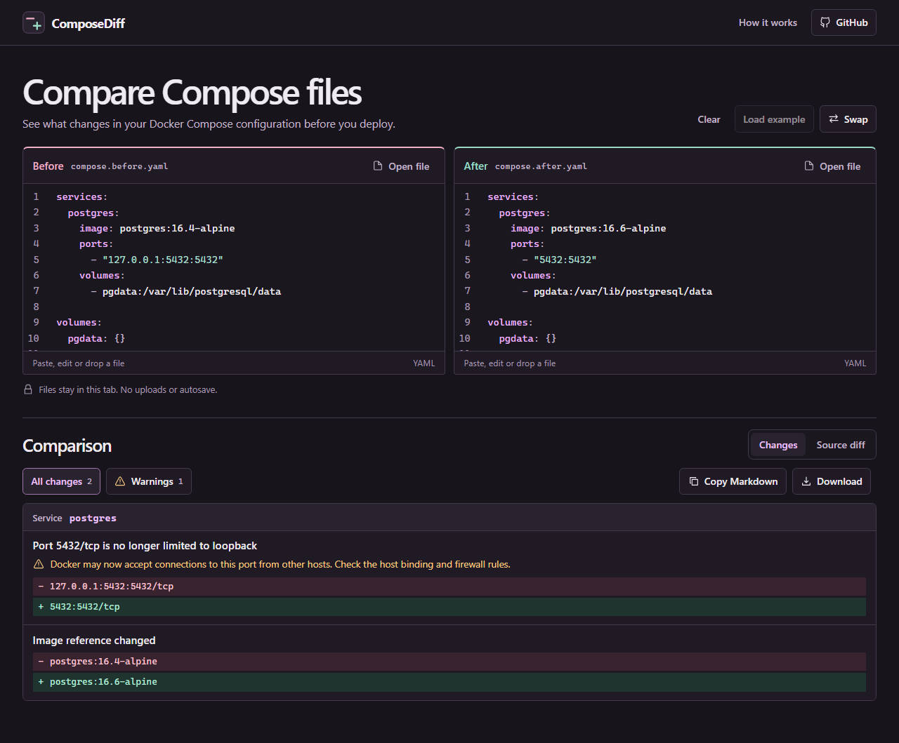
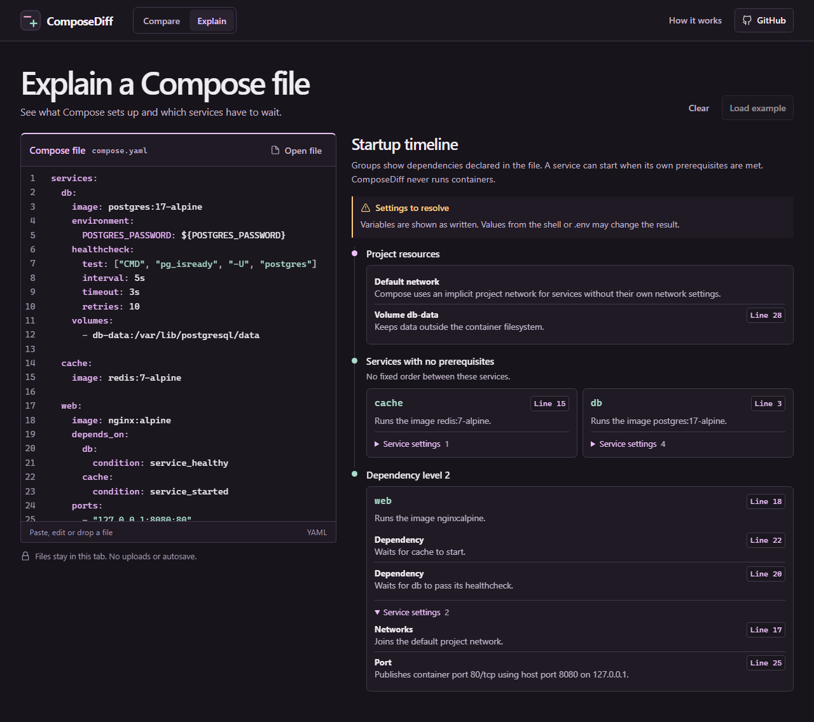

# ComposeDiff

Compare two Docker Compose files or see how one file starts its services. Review changes by service and copy a Markdown report into a pull request. The files stay in your tab.

[Try the live demo](https://cyneric.github.io/composediff/). It opens with a PostgreSQL update that changes the port mapping from `127.0.0.1:5432:5432` to `5432:5432`. With Docker's default binding, other hosts may now be able to connect. ComposeDiff flags that change next to the image update.



## Run locally

Clone the repository and run these commands with Node.js 22.18 or newer. You only need Docker to resolve Compose files that depend on other files or your environment.

```sh
npm ci
npm run dev
```

Open the URL printed in your terminal. The example is already loaded. Paste, drop, or open your original file in **Before** and the proposed file in **After**. Each editor accepts up to 500,000 characters. Files must use UTF-8.

## Read the comparison

- **Changes** groups settings by service or project resource. It ignores comments and mapping key order. It matches ports by container port and protocol and mounts by container path. It treats some short and long forms as equivalent. Most other lists keep their order.
- **Warnings** flag a published port that loses an explicit loopback binding at the same host port, as well as newly enabled privileged mode and host networking. A comparison without warnings does not establish that a configuration is safe.
- **Source diff** shows line edits, including comments and formatting. It works even when the YAML cannot be parsed.
- **Copy Markdown** and **Download** export all compared changes, even when you filter the view. Changes and Markdown show counts for edits to service environment variables and hide top-level config and secret definition values. Other fields may contain sensitive values. Review the report before sharing it.

ComposeDiff compares the files you give it. It does not resolve variables, merge override files, or validate against the full Compose schema. To compare the effective configurations, run [`docker compose config`](https://docs.docker.com/reference/cli/docker/compose/config/) for each version in its project directory. Use the same options and environment you use at deploy time, then compare the two outputs. They may contain resolved secrets.

## Explain a Compose file

Select **Explain** and open or paste one file. The startup timeline shows project resources, services that have no prerequisites, and services that wait for others. A dependency lists what Compose waits for, such as a passing healthcheck. Select a line number to jump to the matching YAML. Expand **Service settings** to see what ports, mounts, and other common settings do.



The timeline follows dependencies declared in the file. It cannot predict exact start times, which profiles are active, or whether containers will start successfully. ComposeDiff flags missing dependencies, cycles, and settings that depend on variables, `include`, or `extends`. Use `docker compose config` to see the settings Compose resolves locally. Explain accepts up to 250 services per file.

## Build and test

```sh
npm test
npm run build
```

Serve `dist/` over HTTP for local use or HTTPS for hosting. The build works at a site root or subpath. Use `npm run preview` to check it locally. Copy Markdown needs a secure context such as HTTPS or localhost.

The browser smoke test serves the built site on a local port. Run it with Python 3.12:

```sh
python -m pip install -r tests/requirements.txt
python -m playwright install chromium
python tests/browser.py
```

## Host the demo

For GitHub Pages, select **GitHub Actions** as the source under **Settings → Pages**, then run **Publish demo** on `main` from the Actions tab. The workflow publishes the contents of `dist/`. Pushes and pull requests run checks without publishing the site.

## Contributing

Contributions are welcome. If ComposeDiff gets a file wrong, [open an issue](https://github.com/Cyneric/composediff/issues/new) with a small example that reproduces it. Remove any credentials first. Pull requests with fixes, tests, or clearer explanations are welcome too.

## License

ComposeDiff is released under the [MIT License](LICENSE). Use it for any purpose, including commercial work. You can modify it and share or sell copies. Keep the copyright and license notices with any copies or substantial portions you distribute.
